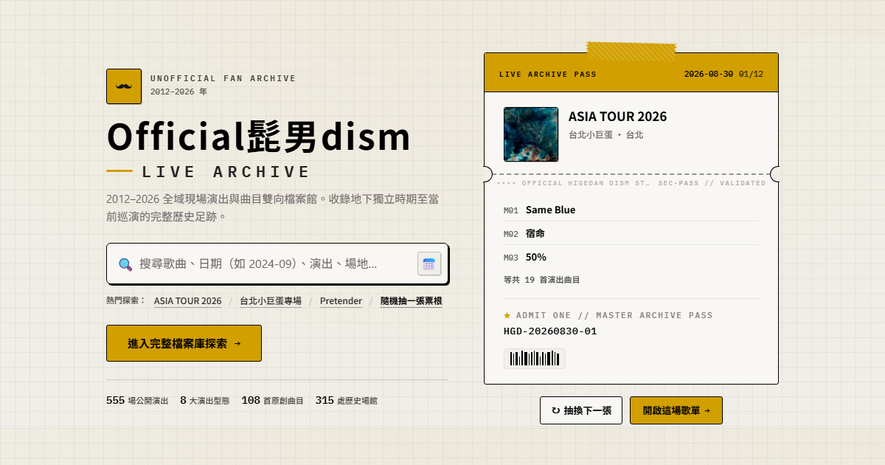

<div align="center">

# Official髭男dism LIVE ARCHIVE

**收錄 Official 髭男 dism 2012 年至今的公開演出場次與曲目，提供歌曲與場次的雙向極速檢索與離線個人巡演票夾。**



[](https://higedan-setlist.higedan-live.workers.dev/)
[](https://higedan-setlist.higedan-live.workers.dev/)

</div>

---

## 這是什麼

**Official髭男dism LIVE ARCHIVE** 是專為 Official 髭男 dism 樂迷打造的靜態優先現場演出檔案庫，完整記錄從 2012 年山陰獨立 Livehouse、日本武道館、Arena 專場到日產體育場的公開演出。全站採零後端純靜態架構與 PWA 離線快取，支援繁體中文、日文、英文與韓文四語系跨語檢索。

## 為什麼需要它

在演唱會前後查閱曲目、比對不同場次的限定編曲，或回顧一首歌從地下時期至今的演出軌跡時，樂迷往往得在社群貼文與零散筆記間反覆拼湊。本專案以 [LiveFans](https://www.livefans.jp/)、官方巡演特設頁與發行出版物進行雙向一手考證，讓「歌曲 → 歷史場次」與「場次 → 完整曲目」都能在單一介面即時互查。

## 你會得到什麼

- **雙向深度檢索**：從任何一首歌追查歷年登場場次、版本差異與官方 YouTube／Spotify 舞台；從任何一場演出檢視完整曲目與前場差異（Setlist Diff）。
- **場地地圖與排行殿堂**：瀏覽日本 47 都道府縣與海外巡演城市足跡（`#/map`）、動態巡演路線，以及歌曲與場館出勤排行榜（`#/ranking`）。
- **離線個人巡演票夾**：純本地儲存參戰紀錄、座位筆記與曲庫解鎖率，並可一鍵匯出 540px 紀念明信片 PNG（`#/tickets`）。

## 工作方式

所有演出資料以結構化 JSON 儲存於 `data/`（區分 `tours/`、`events/` 與 `songs/`），巡演專場採用「共識模板＋場次差異（Diff）」演算法自動比對定番與輪換曲目，並以 `sync-data.mjs` 編譯為前端靜態資料包。個人巡演票夾的打卡紀錄與紀念卡匯出全程於瀏覽器本地運算，不依賴任何後端伺服器或個人資料上傳。

## 快速開始

直接開啟線上公開檔案庫即可開始檢索與建立個人票夾：

- **線上檔案庫**：[higedan-setlist.higedan-live.workers.dev](https://higedan-setlist.higedan-live.workers.dev/)

### 本地預覽與開發

環境需求：Node.js `>= 22.13.0` 與 `pnpm 11`。

```bash
git clone https://github.com/z82529371/higedan-setlist.git
cd higedan-setlist
pnpm install
pnpm sync
pnpm dev
```

執行完整驗證（Lint、四語系檢查與測試套件）：

```bash
pnpm check
```

更多領域模型、產品架構與視覺規範請參閱 [`CONTEXT.md`](./CONTEXT.md)、[`PRODUCT.md`](./PRODUCT.md)、[`DESIGN.md`](./DESIGN.md) 與 [`docs/adr/`](./docs/adr/)。

## 免責聲明

1. 本專案為歌迷社群獨立整理之非官方、非營利開放原始碼文化檔案庫，與 Official 髭男 dism 及所屬經紀公司無直接隸屬關係。
2. 網站中提及之樂團名稱、商標、歌曲名稱、專輯封面及相關影音資產之著作權均屬 **Official 髭男 dism**、**IRORI Records / PONY CANYON INC.** 及各相關權利人所有。
3. 歷史演出資料僅供歌迷探索、交流與紀念使用；若有場次勘誤或一手佐證提供，歡迎透過 Instagram [@higedan_live](https://www.instagram.com/higedan_live/) 回報。
